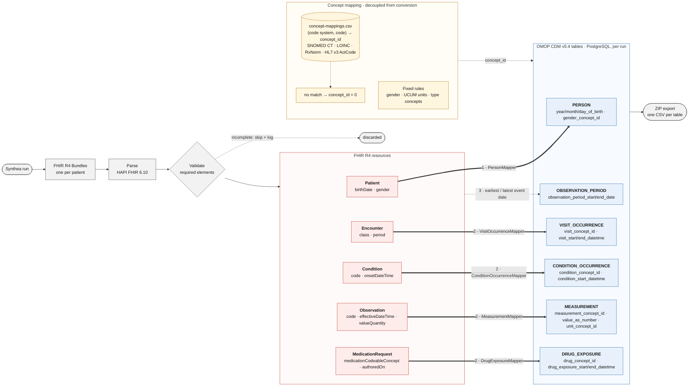

# SyntheaWeb

SyntheaWeb is a web-based platform, developed at the Medical University of Vienna, for generating and interactively inspecting synthetic healthcare data produced by Synthea™. It gives researchers, students and healthcare professionals easy access to realistic but entirely artificial patient data, so they can work without the privacy and data-protection constraints that apply to real patient records.

## What is Synthea?

[Synthea™](https://synthetichealth.github.io/synthea/) is an open-source synthetic patient generator developed by The MITRE Corporation. It simulates the life histories of whole populations, including demographics, encounters, diagnoses, medications and observations, and exports them as HL7® FHIR® resources. Because no real persons are involved, the data is well suited to research, teaching and software testing.

## Features

- **Web-based generation** – Configure and start Synthea runs through a browser interface.
- **Interactive inspection** – Browse, filter and review the generated patients and their clinical records.
- **FHIR to OMOP CDM conversion** – Convert generated FHIR R4 bundles into OMOP CDM tables and export them as CSV files ([details](#fhir-to-omop-cdm-mapping)).
- **AI-generated patient summaries** – Summarise a patient's record with a locally hosted large language model ([details](#ai-generated-patient-summaries)).
- **Containerised deployment** – Runs entirely in Docker, with no manual installation of dependencies.

## FHIR to OMOP CDM Mapping

> **Note:** The FHIR to OMOP CDM conversion is developed on the [`feature/fhir_to_omop`](https://github.com/adnanjoun/web_synth/tree/feature/fhir_to_omop) branch. To use the current version of this feature, switch to that branch before building:
>
> ```sh
> git checkout feature/fhir_to_omop
> ```

SyntheaWeb converts the HL7® FHIR® R4 bundles produced by Synthea into tables of the OHDSI OMOP Common Data Model (CDM) v5.4. Each run's bundles are parsed with HAPI FHIR, checked by a minimal validation step, mapped resource by resource, stored in the backend database and exported as one CSV file per table in a ZIP archive.

### Conversion overview



Processing order per bundle: **(1)** `Patient` resources are mapped first, so that **(2)** `Encounter`, `Condition`, `Observation` and `MedicationRequest` resources can resolve their `subject` reference to the corresponding `person_id`; **(3)** after all events are mapped, one `OBSERVATION_PERIOD` per person is derived from the earliest and latest event date. Resources lacking required elements are skipped and logged. Concept identifiers are supplied by the decoupled concept-mapping layer.

### Resource-to-table mapping

| FHIR R4 resource | OMOP CDM table | Mapped elements (FHIR → OMOP) | Type concept |
|---|---|---|---|
| `Patient` | `PERSON` | `birthDate` → `year_of_birth`, `month_of_birth`, `day_of_birth`; `gender` → `gender_concept_id` | — |
| `Condition` | `CONDITION_OCCURRENCE` | `onsetDateTime` (fallback: `recordedDate`) → `condition_start_date[time]`; `code.coding[0]` → `condition_concept_id` | 32817 (EHR) |
| `Observation` | `MEASUREMENT` | `effectiveDateTime` → `measurement_date[time]`; `code.coding[0]` → `measurement_concept_id`, `measurement_source_value`; `valueQuantity.value` → `value_as_number`; `valueQuantity.code` (UCUM) → `unit_concept_id` | 32856 (Lab result) |
| `Encounter` | `VISIT_OCCURRENCE` | `period.start`/`period.end` → `visit_start/end_date[time]`; `class` (v3-ActCode) → `visit_concept_id` | 32817 (EHR) |
| `MedicationRequest` | `DRUG_EXPOSURE` | `authoredOn` → `drug_exposure_start_date[time]`; `dispenseRequest.validityPeriod.end` (fallback: `authoredOn`) → `drug_exposure_end_date[time]`; `medicationCodeableConcept.coding[0]` → `drug_concept_id` | 38000177 (Prescription written) |
| *(derived)* | `OBSERVATION_PERIOD` | per person: earliest and latest date across the mapped `Condition`, `Observation`, `Encounter` and `MedicationRequest` resources → `observation_period_start/end_date` | 44814724 (Period covering healthcare encounters) |

### Vocabulary mapping

Source codes are resolved to OMOP `concept_id`s using the key `coding.system | coding.code`. The lookup table is [`backend/src/main/resources/concept-mappings.csv`](backend/src/main/resources/concept-mappings.csv), which covers selected SNOMED CT (conditions), LOINC (measurements), RxNorm (drugs) and HL7 v3 ActCode (encounter class: `IMP` → 9201 Inpatient Visit, `AMB` → 9202 Outpatient Visit, `EMER` → 9203 Emergency Room Visit, `VR`). Administrative gender (`male` 8507, `female` 8532, `other` 8551) and UCUM units are mapped by fixed tables in `ConceptMappingService`. Any code that has no mapping gets `concept_id = 0` (No matching concept), as the OMOP conventions require.

Implementation: [`backend/src/main/java/com/syntheaweb/backend/mapperFhir/`](backend/src/main/java/com/syntheaweb/backend/mapperFhir/), [`FhirService`](backend/src/main/java/com/syntheaweb/backend/service/FhirService.java), [`ConceptMappingService`](backend/src/main/java/com/syntheaweb/backend/service/ConceptMappingService.java).

## AI-Generated Patient Summaries

SyntheaWeb can generate a short clinical summary for each synthetic patient using a locally hosted large language model (LLM). No patient data leaves the deployment.

### Architecture

- **Spring Boot backend** (`/api/ai/summaries/generate`, single or bulk): creates a summary record with status `PENDING` and runs generation asynchronously, so long inference times do not cause request timeouts. On completion the record is set to `COMPLETED` (or `FAILED`), and the frontend polls this status.
- **Python AI service** ([`ai_service/`](ai_service/), FastAPI, Hugging Face Transformers, `POST /summarize`): loads the model once at startup and keeps it in memory. Models are selected through an enum/registry pattern, so the service is model-agnostic. The current model is **MedGemma**, loaded from `ai_service/models/medgemma`.
- **Decoding** is greedy (`do_sample=False`, at most 512 new tokens), so the same input always produces the same summary.

### Input preparation

Raw FHIR bundles are too large and too deeply nested to fit in the model's context window. Truncating or blindly compressing the JSON led to missed clinical events and hallucinations. Instead, [`FhirExtractionService`](backend/src/main/java/com/syntheaweb/backend/service/FhirExtractionService.java) builds a compact, structured text snapshot for each patient:

| Snapshot section | Source | Filter |
|---|---|---|
| Demographics (name, age, gender, location) | SyntheaWeb database | — |
| Active diagnoses | FHIR `Condition` | `clinicalStatus = active` |
| Current medications | FHIR `MedicationRequest` | `status = active` |
| Encounters and procedures | FHIR `Encounter`, `Procedure` | excludes cancelled / entered-in-error / not-done |
| Allergies | FHIR `AllergyIntolerance` | `clinicalStatus = active` |
| Observations and vitals | FHIR `Observation` (value, unit, date) | excludes cancelled / entered-in-error |
| Immunizations | FHIR `Immunization` | excludes not-done / entered-in-error |

Each section keeps at most the 20 most recent entries. Age is taken from the database rather than calculated by the model. The snapshot is placed into a fixed prompt ([`ai_service/assets/summarize-prompt.txt`](ai_service/assets/summarize-prompt.txt)), which asks for one sentence each on demographics, active diagnoses, current medications, key medical history and allergies. The service additionally caps the input at 8,000 characters to stay within memory limits.

## Installation & Setup

### Prerequisites

- [Docker](https://docs.docker.com/get-docker/) (on Windows: Docker Desktop with WSL 2) and [Docker Compose](https://docs.docker.com/compose/install/).
- For AI-generated summaries: a [Hugging Face](https://huggingface.co/) account with access to the gated MedGemma model, and enough memory for the model to run (in testing, the AI container was given 30 GB of RAM).

### Run SyntheaWeb with Docker

1. **Make sure Docker is running.**

2. **Clone the repository:**

   ```sh
   git clone https://github.com/adnanjoun/web_synth.git
   cd web_synth
   ```

3. **Download the AI model.** Model weights are too large to store in Git. Install the Hugging Face CLI, log in and download the model into the expected directory:

   ```sh
   pip install huggingface_hub
   hf auth login
   hf download google/medgemma-1.5-4b-it --local-dir ./ai_service/models/medgemma
   ```

   To add or replace a model, follow the same steps with the corresponding model identifier and directory.

4. **(Optional) Change the credentials** in the included `.env` file.

5. **Start the application:**

   ```sh
   docker-compose up --build
   ```

   The first build takes a few minutes.

6. **Open the application.** When all containers are running and the log shows

   ```sh
   synthea exited with code 0
   ```

   open [http://localhost:3000/syntheaweb](http://localhost:3000/syntheaweb) in your browser.

7. **Register and start generating.**

> **Note:** The first Synthea run takes longer because Gradle has to build Synthea first.

## Contact

For inquiries, please contact the main supervisor, Dr. Adnan Jouned: adnan.jouned@meduniwien.ac.at

## License & Citation

This work is licensed under the [Apache License 2.0](LICENSE). If you use SyntheaWeb, please cite it using the metadata in [CITATION.cff](CITATION.cff).

## Participants

SyntheaWeb is developed at the Institute of Medical Information Management, Center for Medical Data Science, Medical University of Vienna.

**Main supervisor**

- Dr. Adnan Jouned

**Development**

- Osman Cirak – initial implementation of the SyntheaWeb platform
- Elena Kappel – platform extension, bug fixes, asynchronous Synthea generation and AI-generated patient summaries
- Emília Matonoková – FHIR to OMOP CDM pipeline (ingestion, mapping, export and frontend integration)

**Content and scientific quality**

- Maximilian Schubert
- Dr. Florian Katsch
- Prof. Dr. Georg Duftschmid
